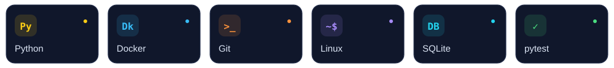
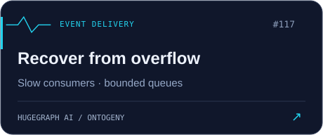
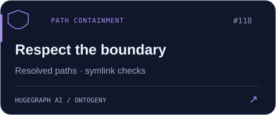
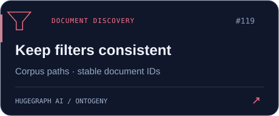

<p align="center">
  
</p>

<p align="center">
  <b>你好，我是 SeasonMay 👋</b><br />
  从端侧 AI 到应用工程，把好奇心写进代码，把问题变成可验证的改进。
</p>

<p align="center">
  <a href="https://github.com/SeasonMay?tab=repositories"><b>⌘ 项目仓库</b></a> &nbsp; / &nbsp;
  <a href="https://github.com/pulls?q=is%3Apr+author%3ASeasonMay"><b>↗ 开源贡献</b></a> &nbsp; / &nbsp;
  <a href="https://github.com/SeasonMay?tab=stars"><b>✦ 探索收藏</b></a>
</p>

### 🧑‍💻 About / 正在探索

```python
class SeasonMay:
    interests = ["AI", "Systems", "Edge"]
    currently = "HugeGraph AI / Ontogeny"
    workflow  = "Reproduce → Fix → Verify"
```

关注 AI 与数据如何连接到真实应用，也关心系统在边界条件下是否依然可靠。最近在阅读 Ontogeny 源码，通过本地复现、回归测试和小型 PR 参与开源。

### 🛠 Toolkit / 实践工具



### ⚡ Open source / 从问题到修复

<p align="center">
  <a href="https://github.com/hugegraph/hugegraph-ai/pull/117"></a>
  <a href="https://github.com/hugegraph/hugegraph-ai/pull/118"></a>
  <a href="https://github.com/hugegraph/hugegraph-ai/pull/119"></a>
</p>

- **事件通知** → 慢订阅者溢出时明确提示重新同步，保持正常订阅者独立运行。
- **路径边界** → 解析真实路径后检查目录包含关系，覆盖相邻目录与符号链接。
- **文档发现** → 统一过滤路径基准，同时保留已有文档 ID。

<details>
<summary><b>展开更多贡献与验证方式 ↗</b></summary>

| PR | 解决的问题 |
| :--- | :--- |
| [#104](https://github.com/hugegraph/hugegraph-ai/pull/104) | glob 选择器绕过 Store 的 include/exclude |
| [#106](https://github.com/hugegraph/hugegraph-ai/pull/106) | 指定单文件却扫描同目录其他文档 |

使用真实临时文件、pytest 与 Docker 对比修复前后的行为，并记录验证范围。以上链接为已提交贡献，合并与审查状态以对应 PR 页面为准。

</details>

### 🧭 Explore / 项目入口

| 🧩 应用工程 | 🤖 AI 与设备 |
| :--- | :--- |
| **[SafeMicroService](https://github.com/SeasonMay/SafeMicroService)**<br />微服务项目仓库 | **[RK3588 Stable Diffusion](https://github.com/SeasonMay/RK3588-stable-diffusion-GPU)**<br />RK3588 Mali GPU 上的生成式 AI · Fork |
| **[deepmemo](https://github.com/SeasonMay/deepmemo)**<br />本地优先的知识库与问答工作台 · Fork | **[RISC-V Board Wandering](https://github.com/SeasonMay/riscv-board-wandering)**<br />RISC-V 开发板探索 · Fork |

<sub>Fork 项目保留上游作者归属；个人改动以实际提交记录为准。</sub>


<details>
<summary>Design notes</summary>

视觉灵感来自 [Awesome GitHub Profile README](https://github.com/abhisheknaiidu/awesome-github-profile-readme)、[Readme Typing SVG](https://github.com/DenverCoder1/readme-typing-svg) 和 [Capsule Render](https://github.com/kyechan99/capsule-render) 的终端、动态文字与横幅形式。本站 SVG 为自制图形，保存在仓库内；无需外部统计服务或定时工作流。可通过 `python tools/build_assets.py` 重新生成。

</details>
