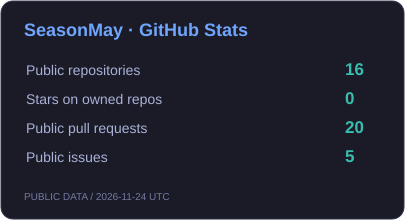
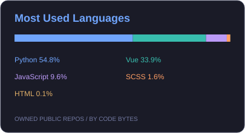

# 👋 Hi, I'm SeasonMay

**让 Agent 记得住，也用得好。**

[项目仓库](https://github.com/SeasonMay?tab=repositories) · [开源贡献](https://github.com/pulls?q=is%3Apr+author%3ASeasonMay) · [探索收藏](https://github.com/SeasonMay?tab=stars)

## 🧑‍💻 关于我

- 🧠 关注 **AI Agent、长期记忆与上下文检索**。
- 🔬 最近在 **腾讯 TencentDB Agent Memory** 上探索来源反馈评估与预算约束检索。
- 🛠 喜欢把想法做成能运行、能复现、能对比的实验。
- 🌱 也在探索端侧 AI、知识库与应用工程。

## 🚀 重点贡献 · Agent Memory

**记忆检索不只看召回了什么，也要验证哪些来源真正帮助了回答。**

我提交了一个基于 MemoryCore 的独立实验示例：通过移除来源与匹配对照评估记忆作用，将反馈用于检索排序，在 Token 预算内选择上下文，并在辅助链路异常时回退到原生检索。

[查看我的 PR #1369 ↗](https://github.com/TencentCloud/TencentDB-Agent-Memory/pull/1369) · [腾讯上游项目](https://github.com/TencentCloud/TencentDB-Agent-Memory) · [我的 Fork](https://github.com/SeasonMay/TencentDB-Agent-Memory)

贡献为独立示例，实验设置、结果和审查状态见 PR；不代表项目整体或生产效果。

## 📊 GitHub 数据

  
  

每日更新；语言分布按自有公开非 Fork 仓库的代码字节统计，不代表熟练度。

## 🐍 贡献足迹

<picture>
  <source media="(prefers-color-scheme: dark)" srcset="./profile/snake-dark.svg" />
  <source media="(prefers-color-scheme: light)" srcset="./profile/snake.svg" />
  
</picture>

## 🧭 继续探索

| 项目 | 方向 |
| :--- | :--- |
| [SafeMicroService](https://github.com/SeasonMay/SafeMicroService) | 应用工程 |
| [RK3588 Stable Diffusion](https://github.com/SeasonMay/RK3588-stable-diffusion-GPU) | 端侧生成式 AI · Fork |
| [deepmemo](https://github.com/SeasonMay/deepmemo) | 本地知识库与问答 · Fork |

🛠 其他开源贡献

在 HugeGraph AI / Ontogeny 中提交了事件通知、路径边界和文档发现相关修复：

[SSE 溢出提示 #117](https://github.com/hugegraph/hugegraph-ai/pull/117) · [路径边界 #118](https://github.com/hugegraph/hugegraph-ai/pull/118) · [文档过滤 #119](https://github.com/hugegraph/hugegraph-ai/pull/119) · [glob 过滤 #104](https://github.com/hugegraph/hugegraph-ai/pull/104) · [单文件扫描 #106](https://github.com/hugegraph/hugegraph-ai/pull/106)

---

Stay curious. Keep building. 
Layout inspiration: <a href="https://github.com/zlh123123">zlh123123</a> · Animation: <a href="https://github.com/Platane/snk">snk</a> / <a href="https://github.com/DenverCoder1/readme-typing-svg">Typing SVG</a>

